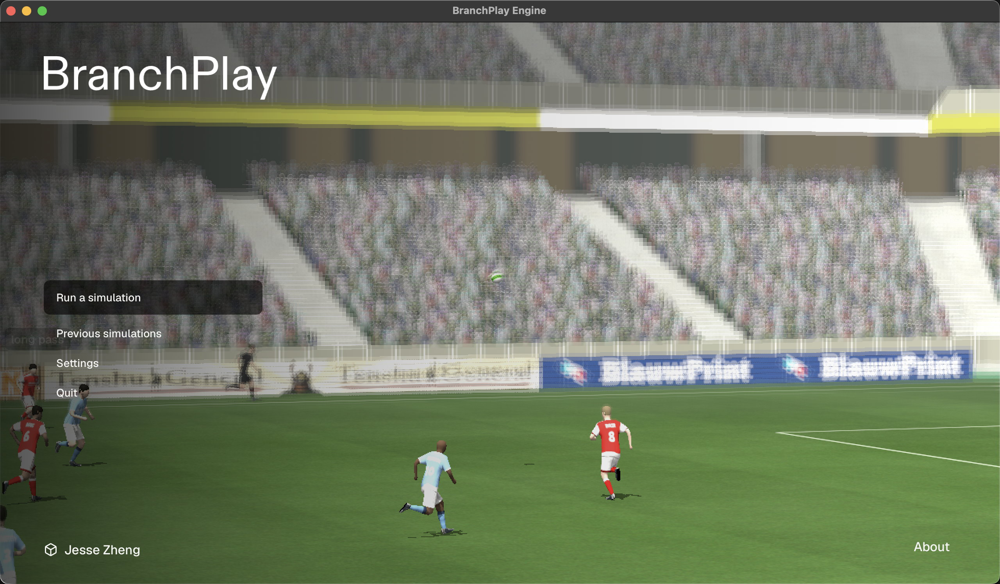
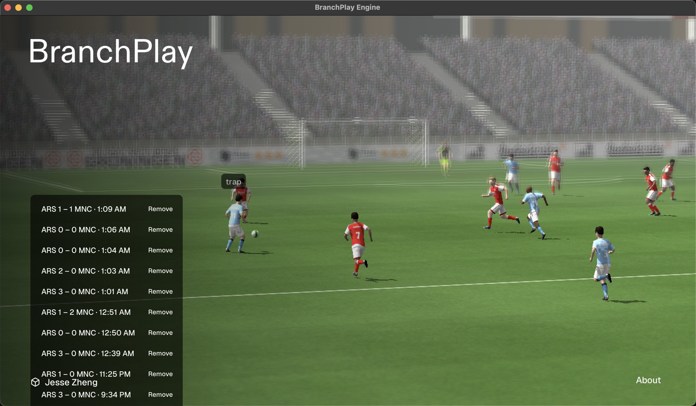
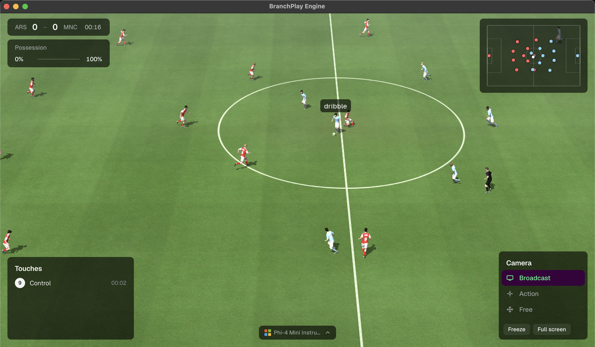

# BranchPlay

Open-source counterfactuals engine for football. Coaches and broadcasters revisit a simulated moment and run alternate outcomes.

This is a macOS app, built for Apple Silicon.

The demo: [watch the match](https://youtu.be/LhdAMsLKgiQ?si=owi_gjCEgOt-Pz6r).

The menu:



Saved matches:



A match:



## Run

On an Apple Silicon Mac, install [Homebrew](https://brew.sh) and the Xcode command line tools, then from this folder:

```shell
./scripts/setup.sh
```

When they are missing, that installs three Homebrew packages: `python@3.11`, `sdl2-compat`, and `ollama`. It then builds the local Python environment, the football engine, and the match controls, starts Ollama, and downloads Phi-4 mini. Match chat and the key-moment text use that model. Those products stay on the machine. They are not part of the source.

Then double-click `BranchPlay.app`. If a match is already open, a second click brings that window forward.

The same launch from the project folder:

```shell
DYLD_LIBRARY_PATH=.deps/prefix/lib GRF/.venv/bin/python -u viewer/watch.py
```

## Layout

| Path | What it is |
| --- | --- |
| `BranchPlay.app` | Launcher. It starts the match in this folder. |
| `viewer/` | Match window, overlay, broadcast graphics, and tests. |
| `viewer/ui/` | The controls page. `dist/` is the page the app serves. |
| `GRF/` | Vendored Google Research Football, including the Gameplay Football engine. |
| `docs/` | Engine behavior and the in-window controls. |

BranchPlay code stays outside `GRF/`, except for engine changes recorded in [docs/engine-capabilities.md](docs/engine-capabilities.md).

## Tests

From `viewer/`, with the local environment:

```shell
DYLD_LIBRARY_PATH=../.deps/prefix/lib ../GRF/.venv/bin/python test_saves.py
```

The other checks are `test_broadcast.py`, `test_match_chat.py`, `test_moment.py`, `test_formations.py`, and `test_moment_page.py`. The last one asks the local Phi-4 mini model for a paragraph.

## Credits

BranchPlay's own files, outside `GRF/` and the fonts, do not have a separate license file yet.

Google Research Football in `GRF/` is Apache License 2.0. See [GRF/LICENSE](GRF/LICENSE).

The Gameplay Football engine in `GRF/third_party/gfootball_engine/` is public domain under [the Unlicense](GRF/third_party/gfootball_engine/LICENSE). It was originally written by Bastiaan Konings Schuiling and incorporated by Google Research.

Geist and Montserrat, in `viewer/fonts/`, are under the SIL Open Font License. The license text is beside the files.
